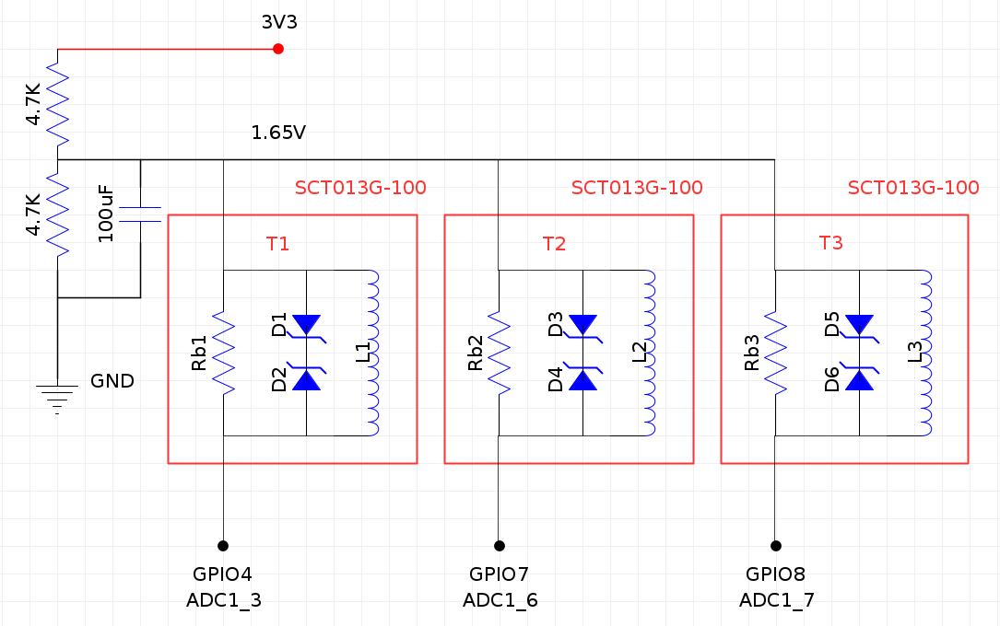
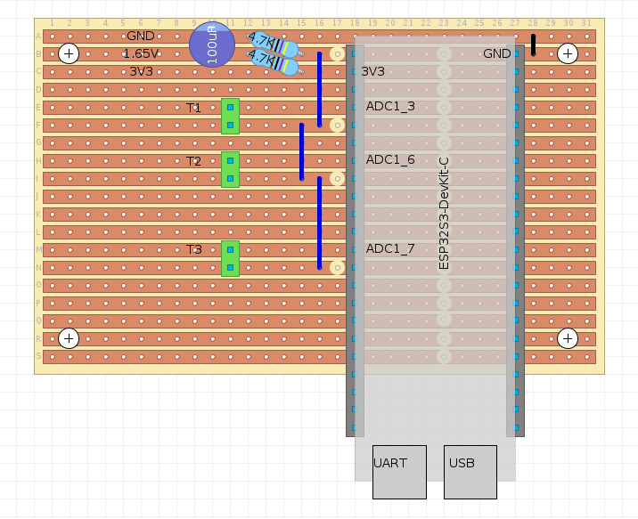

# tuova-iot

> ## IMPORTANT!
>
> This repository was created as part of the TUOVA Project (see https://tuova.savonia.fi and https://tuovaproject.github.io/). Some of the information presented here might assume familiarity with other repositories created during the course of the project. For more details on those, see the "Additional Information" section at the bottom of this README.
>
> ### Author
>
> Mika Leskinen \<mika.leskinen@savonia.fi\>\
> R&D Specialist\
> Savonia University of Applied Sciences
>
> 
>
> **Everything is provided as-is, use at your own risk.**
>
> TUOVA Project co-funded by the European Union / Etelä-Savon ELY-keskus.
>
> 

## General

This repository consists of three parts:

1. Source code for an ESP32-based system that can measure electric current (in `./esp32`)
2. A Nodejs script for e.g. a Raspberry Pi that reads values from the ESP32 and sends them to a database (in `./raspi`)
3. Documentation, most notably schematics and layout diagrams for the current measurement circuit (in `./docs`).

The system presented here can be used to monitor the usage of an electric applicance, which in this case is a 3-phase multi-function CNC machine.
The ESP32 uses clamp current transformers to measure the electric current flowing through the phase wires (`L1`, `L2` and `L3`) of the appliance.

Current is first converted into an AC voltage (1VAC) by burden resistors built-in to the current transformers, and this AC voltage is biased with a +1.65VDC voltage to make it measurable with the ADC of the ESP32. The ESP32 reads this voltage and calculates the RMS current based on specific parameters, namely the measuring range of the transformer (0A to 100A), the ADC resolution (12 bits), the ADC voltage range (0V to 3.3V) and the amount of readings to average on (1000). The ESP32 repeats this measuring cycle every 500ms and makes the latest measurement results available through its UART port (in this case, the USB UART port specifically).

The Raspberry Pi acts as an intermediary device, which has network access to an InfluxDB database. The Pi polls for values from the ESP32 through USB UART once every second, adds timestamps to the measurements and finally sends the formatted data to InfluxDB for further processing.

It is worth noting that in a "more ideal" setup the Raspberry Pi would not be needed at all, since many later ESP32 dev boards have WLAN and RTC capabilities already built in. That said, having the Pi in between makes it easier to troubleshoot issues remotely during development, which was in fact the main reason to include it here.

## Prerequisites

- It is assumed that an InfluxDB database is already deployed.
- Some prior experience with ESP32-based microcontrollers, Raspberry Pi devices and electronics/electrics in general might be required.

## Example deployment

### Components used

- ESP32S3-Devkit-C
    - see https://docs.espressif.com/projects/esp-dev-kits/en/latest/esp32s3/esp32-s3-devkitc-1/index.html
- Raspberry Pi Zero 2W
    - see https://learn.sparkfun.com/tutorials/getting-started-with-the-raspberry-pi-zero-2-w/all
- YHDC SCT013G-100 current transformers (x3)
    - NOTE: it is essential for the transformer to have a 1VAC **VOLTAGE OUTPUT**
    - at the time of writing, the **correct** datasheet for SCT013G-100 (plus others in the series) is available at: https://manuals.plus/m/b0df3358bc1e27b761e53cfe9474ff9e9c3c1950df7ac877acda98f0570c738e_optim.pdf
    - NOTE: double check the exact type of transformer you happen to receive to avoid most magic smoke events
- piece of stripboard/perfboard/Veroboard
- 1x18 (female) pin headers (x2)
- 100uF electrolytic capacitor (x1)
- 4.7kOhm 1% resistors (x2)
- 2-pole screw terminal blocks (x3)
- jump wires (xX)
- USB Micro-B (male) to USB A (female) adapter (aka "OTG")
- USB A (male) to USB Micro-B (male) cable
- 5VDC power supply with USB Micro-B (male) connector (a phone charger rated at 1-1.5A could do)
- a big enough electric distribution/assembly box
- screws, zip ties, electric tape and other essentials.

### ESP32 software setup

Probably the easiest way to deploy the ESP32 application (in `./esp32/esp32.ino`) onto the device is by using Arduino IDE (see https://www.arduino.cc/en/software/).
Note that the `esp32` board definitions by Espressif Systems need to be installed into the Arduino environment by using Arduino IDE's "Boards Manager"
(for more information, see https://github.com/espressif/arduino-esp32).

If using Arduino IDE, the deployment process would be as follows:

1. Load the file `./esp32/esp32.ino` into Arduino IDE
2. Connect the ESP32 board to the dev machine with a USB cable
3. Select the correct `Board` and `Port` from `Tools` -> `Board` and `Tools` -> `Port`, respectively
4. Click the Upload button in the top left corner (the right-arrow one)
5. Check that the board responds to commands (`m`, `c` and `r` in this case):
    - Select `Tools` -> `Serial Monitor`
    - Set `Baud` to `115200`
    - Send the character `m` to the serial port (try `c` and `r`, too).

Pro Tip: it is advised to check if the measurement circuit (see below) works as intended with the ESP32 device before installing anything into the assembly box.

### Hardware setup

> IMPORTANT: while no modifications to high-voltage systems are required in this setup, always be sure to:
>
> - keep SAFETY as the first priority,
> - keep LAWS AND REGULATIONS as the second priority and
> - keep the actual function and outcome of the setup a distant third priority (or fourth, if you're also the learning type).
>
> TL;DR: **don't mess with electricity unless you know what you're doing!**

The process of physically setting up the entire current monitoring system could be as follows:

1. Assemble and solder the electronics on the perfboard as per the images below:
    > Schematic:
    >
    > 
    >
    > Example stripboard layout (note that the copper strips seen in the image are actually on the backside of the board):
    >
    > 
    - for a DIY Layout Creator file, see `./docs/diylc-layout.diy`
    - Pro Tip: use the 18-pin headers to connect the ESP32 to the perfboard, don't solder the ESP32 there directly
    - Pro Tip #2: use a 4mm drill bit to make all 22 trace cuts seen in the image (you **did** notice those, right?)
2. Attach the completed perfboard circuit into the assembly box with screws
3. Bring the current transformer wires into the assembly box
    - note any dust/moisture protection requirements your environment might have
4. Connect each pair of transformer wires to each of the 3 screw terminal blocks on the perfboard
    - polarity shouldn't matter, but in this case the core of the coax cable was connected to `1.65V` and the sleeve/shield to `ADC` (probably)
    - some transformers come with 3.5mm audio jacks, and in this case those were removed to save space
5. Make sure that the Raspberry Pi is equipped with an SD card, operating system and some way to connect to it later (e.g. WLAN + ssh)
6. Connect the `UART` port of the ESP32 into one of the USB ports on the Raspberry Pi (use the "OTG" adapter here since the Pi Zero only has Micro-B connectors)
7. Place the Raspberry Pi on top of the ESP32 board in the assembly box (put some isolating material in between to avoid shorts)
8. Bring the 5V USB power supply cable into the assembly box and connect it to the other USB connector on the Pi
9. Close the assembly box, and you should end up with a closed box that has a power supply and 3 transformers dangling outside
10. Bring the whole assembly to whatever machine you wish to monitor, and locate the 3 phase wires that would have current flowing through them when the machine operates
    - be sure to turn off all power to the machine before installations, even when working with galvanically isolated components like the transformers used here
    - in this case the transformers were installed around the 3 phase wires at the main switch of the machine, but it could make sense to measure current from other places, too
11. Wrap the current transformer clamps around the selected phase wires (orientation shouldn't matter)
12. Plug the 5V power supply of the Pi into a wall outlet.

### Raspberry Pi software setup

The Raspberry Pi software is a NodeJS app that can be run as a "daemon" with Docker. The deployment process could be as follows:

1. Create a `.env` file as per `./raspi/.env.example` (`cp ./raspi/.env.example ./raspi/.env`)
2. Set the variables in `.env` as appropriate:
    - `SERIAL_PATH`: path to the serial port (UART) used for communicating with the ESP32
    - `SERIAL_BAUD`: the serial port's baudrate (set this to whatever `Serial.begin()` has in `./esp32/esp32.ino`, by default it's `115200`)
    - `INFLUXDB_API_BASE_URL`: the URL of your InfluxDB database's HTTP API
    - `INFLUXDB_API_TOKEN`: your InfluxDB API token (with write permissions to `INFLUXDB_API_BUCKET`)
    - `INFLUXDB_API_ORG`: your InfluxDB organization name
    - `INFLUXDB_API_BUCKET`: your InfluxDB bucket name
    - `INFLUXDB_MEASUREMENT_NAME`: your desired InfluxDB measurement name
    - `INFLUXDB_SENSOR_ID`: desired value for your InfluxDB `sensor_id` tag
    - `NODE_TLS_REJECT_UNAUTHORIZED`: set this to `0` if e.g. using self-signed TLS certs on InfluxDB

3. Run the build script with `./build-raspi.sh`
4. Copy contents of the resulting folder (`./raspi-build`) over to the Pi (e.g. with `scp`)
5. Access the Pi (e.g. with `ssh`) and navigate to wherever you copied the `./raspi-build` folder contents
6. Run `docker compose up -d`.

If everything went as planned, the application would now be running in daemon mode on the Pi, which means that it should e.g. come back up after reboots.

## Notes

If nothing in this README (or the code) makes sense, feel free to improve.

## LICENSE

See [LICENSE](LICENSE)

## Additional Information

### The TUOVA Project

- https://tuova.savonia.fi
- https://tuovaproject.github.io/

### The data model ("Tuotantotiedon tietomalli")

- https://github.com/TUOVAProject/tuotantotiedon-tietomalli
- https://tuovaproject.github.io/tuotantotiedon-tietomalli/

### On-premises server environment

- https://github.com/TUOVAProject/tuova_on_prem_server

### Sensor data collection system

- https://github.com/TUOVAProject/tuova-iot

### Energy analyzer data collection system

- https://github.com/TUOVAProject/tuova_energymeter

### Sensor data ETL process

- https://github.com/TUOVAProject/tuova-sensor-etl

### Sensor data - further processing

- https://github.com/TUOVAProject/tuova_machinedata_processing
